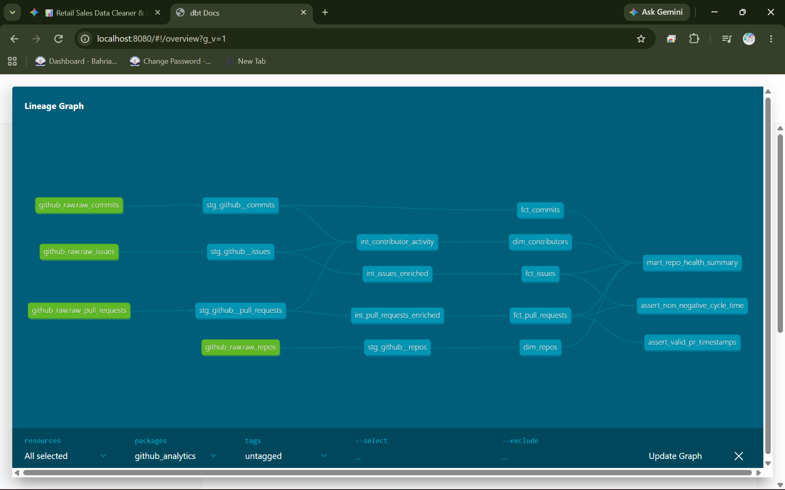
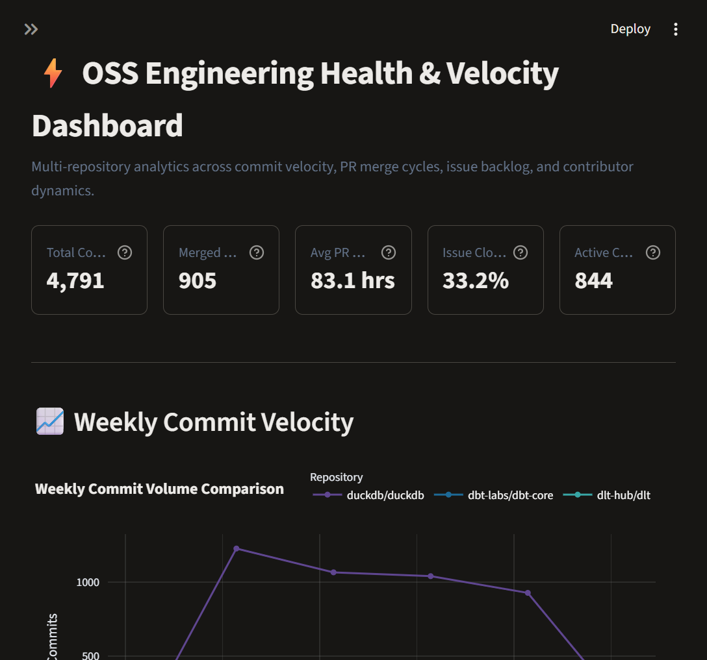

# 🚀 GitHub Analytics Pipeline (Zero-Dollar Modern Data Stack)

[](https://zero-dollar-dhmaqmfwnjd75lmivk3sdd.streamlit.app)
[](https://github.com/OWNER/REPOSITORY/actions/workflows/daily_pipeline.yml)
[](https://duckdb.org/)
[](https://dlthub.com/)
[](https://www.getdbt.com/)
[](https://streamlit.io/)
[](https://motherduck.com/)

> 🌐 **Live Interactive Dashboard:** [zero-dollar-dhmaqmfwnjd75lmivk3sdd.streamlit.app](https://zero-dollar-dhmaqmfwnjd75lmivk3sdd.streamlit.app)

A production-grade, end-to-end analytics engineering pipeline designed to benchmark open-source repository velocity, contributor dynamics, issue backlog health, and pull request review efficiency across major data repositories (`dlt-hub/dlt`, `duckdb/duckdb`, and `dbt-labs/dbt-core`).

Built entirely on a **Zero-Dollar Modern Data Stack**, deploying serverless incremental ingestion, embedded in-process OLAP, modular dbt transformations, automated data testing, and cloud BI visualization at **$0 infrastructure cost**.

---

## 🏗️ Architecture Overview

```text
 ┌────────────────────────────────────────────────────────────────────────────────────────┐
 │                              DATA SOURCE: GITHUB REST API v3                           │
 └──────────────────────────────────────────┬─────────────────────────────────────────────┘
                                            │
                                            ▼
 ┌────────────────────────────────────────────────────────────────────────────────────────┐
 │                      INGESTION ENGINE: dlt (data load tool)                            │
 │  • Incremental cursor tracking (commits, PRs, issues)                                  │
 │  • Auto-pagination (100/page), header authentication & rate-limit backoff             │
 │  • Schema inference, JSON flattening & merge write disposition                         │
 └──────────────────────────────────────────┬─────────────────────────────────────────────┘
                                            │
                     ┌──────────────────────┴──────────────────────┐
                     │                                             │
      [TARGET_ENV=dev]                               [TARGET_ENV=prod]
                     ▼                                             ▼
  ┌─────────────────────────────────────┐       ┌─────────────────────────────────────┐
  │         LOCAL DUCKDB STORAGE        │       │       MOTHERDUCK CLOUD STORAGE      │
  │     data/github_warehouse.duckdb    │       │         md:github_analytics         │
  └──────────────────┬──────────────────┘       └──────────────────┬──────────────────┘
                     │                                             │
                     └──────────────────────┬──────────────────────┘
                                            │
                                            ▼
 ┌────────────────────────────────────────────────────────────────────────────────────────┐
 │                      TRANSFORMATION & TESTING: dbt Core 1.8+                           │
 │                                                                                        │
 │  [Raw Layer]          github_raw (raw_repos, raw_commits, raw_prs, raw_issues)         │
 │                            │                                                           │
 │  [Staging (stg)]      Views: stg_github__repos, commits, pull_requests, issues         │
 │                            │                                                           │
 │  [Intermediate (int)] Views: int_pull_requests_enriched, int_issues_enriched,        │
 │                              int_contributor_activity                                  │
 │                            │                                                           │
 │  [Marts (marts)]      Tables: dim_repos, dim_contributors                             │
 │                               fct_commits, fct_pull_requests, fct_issues               │
 │                               mart_repo_health_summary                                 │
 │                                                                                        │
 │  [Data Quality]       54 schema tests (unique, not_null, relationships, values)        │
 │                       + 2 singular business logic integrity tests                      │
 └──────────────────────────────────────────┬─────────────────────────────────────────────┘
                                            │
                     ┌──────────────────────┴──────────────────────┐
                     │                                             │
                     ▼                                             ▼
 ┌───────────────────────────────────────┐     ┌──────────────────────────────────────────┐
 │      ANALYTICS: STREAMLIT BI APP      │     │     AUTOMATION: GITHUB ACTIONS CI/CD     │
 │  • 5-KPI executive header cards       │     │  • Daily scheduled runs (02:00 UTC)      │
 │  • Plotly weekly commit velocity      │     │  • Incremental dlt load to MotherDuck    │
 │  • PR cycle time & issue backlog      │     │  • dbt build test execution in cloud     │
 │  • Contributor leaderboard & summary  │     │  • Zero-maintenance orchestration        │
 └───────────────────────────────────────┘     └──────────────────────────────────────────┘
```

---

## 📊 Visual Previews

### dbt DAG Lineage


### Streamlit BI Dashboard


---

## 📐 Data Modeling: Medallion & Star Schema

The transformation pipeline adopts a Medallion Architecture leading to a Star Schema optimized for OLAP querying:

```text
github_raw (Bronze)
  ├── raw_repos ────────────────► stg_github__repos ──────────► dim_repos
  │                                                                 │
  ├── raw_commits ──────────────► stg_github__commits ────────► fct_commits
  │                                      │                          │
  ├── raw_pull_requests ────────► stg_github__pull_requests ──► fct_pull_requests
  │                                      │                          │
  └── raw_issues ───────────────► stg_github__issues ─────────► fct_issues
                                         │                          │
                                         ▼                          ▼
                              int_contributor_activity ───► dim_contributors
                                                                    │
                                                                    ▼
                                                       mart_repo_health_summary
```

### Models Catalog

| Layer | Model Name | Materialization | Description |
| :--- | :--- | :--- | :--- |
| **Bronze** | `github_raw.*` | Table (dlt) | Raw ingested GitHub entities with append/merge write disposition. |
| **Silver** | `stg_github__repos` | View | Standardized repository dimensions (stars, forks, open issues). |
| **Silver** | `stg_github__commits` | View | Cleaned commit history, authored timestamp, and author login fallback. |
| **Silver** | `stg_github__pull_requests` | View | Standardized PR status lifecycle (`open`, `closed`, `merged`), timestamps. |
| **Silver** | `stg_github__issues` | View | Issue status lifecycle excluding pull requests. |
| **Silver** | `int_pull_requests_enriched`| View | Feature engineering: `hours_to_merge`, `is_merged`, `created_date`. |
| **Silver** | `int_issues_enriched` | View | Feature engineering: `hours_to_close`, `is_closed`, `is_stale` (>30d). |
| **Silver** | `int_contributor_activity` | View | Cross-entity author union, bot detection (`is_bot`), first-seen date. |
| **Gold** | `dim_repos` | Table | Repo surrogate key (`md5(repo_full_name)`), metadata, default branch. |
| **Gold** | `dim_contributors` | Table | Contributor key (`md5(author_login)`), bot flag, lifetime counts. |
| **Gold** | `fct_commits` | Table | Grain = 1 row per commit; foreign keys to dim_repos & dim_contributors. |
| **Gold** | `fct_pull_requests` | Table | Grain = 1 row per PR; foreign keys, cycle time hours. |
| **Gold** | `fct_issues` | Table | Grain = 1 row per issue; foreign keys, stale indicators, closure hours. |
| **Gold** | `mart_repo_health_summary` | Table | Pre-aggregated engineering health KPIs per repository. |

---

## 🛡️ Data Quality & Automated Testing

Testing is baked into every layer using dbt's native test harness:

- **54 Schema Tests**:
  - `unique` & `not_null` constraints on all primary keys (`repo_id`, `commit_sha`, `pr_id`, `issue_id`, `repo_key`, `contributor_key`).
  - `accepted_values` validation on `pr_status` (`['open', 'closed', 'merged']`).
  - `relationships` referential integrity checks linking foreign keys from `fct_commits`, `fct_pull_requests`, and `fct_issues` to `dim_repos` and `dim_contributors`.
- **2 Custom Business Logic Tests**:
  - `assert_valid_pr_timestamps`: Validates that no merged PR has `merged_at_utc < created_at_utc`.
  - `assert_non_negative_cycle_time`: Validates that `hours_to_merge` and `hours_to_close` are strictly non-negative.

---

## 🛠️ Local Development (`dev` Target)

### 1. Prerequisites
- Python 3.10+ (recommended 3.12)
- Git

### 2. Installation
```bash
# Clone the repository
git clone https://github.com/OWNER/github-analytics-pipeline.git
cd github-analytics-pipeline

# Create and activate virtual environment
python -m venv .venv
source .venv/bin/activate       # On Linux/macOS
# .venv\Scripts\activate        # On Windows (PowerShell)

# Install dependencies
pip install -r requirements.txt
```

### 3. Configure Environment Variables
Copy `.env.example` to `.env` and fill in your GitHub Personal Access Token:
```bash
cp .env.example .env
```
```env
GITHUB_TOKEN=ghp_your_github_personal_access_token
TARGET_ENV=dev
MOTHERDUCK_TOKEN=
LOOKBACK_DAYS=90
```

### 4. Run Pipeline Locally
```bash
# 1. Run incremental ingestion into local DuckDB
python ingestion/github_pipeline.py

# 2. Run dbt transformations and test suite
cd dbt_project
dbt build --profiles-dir .
cd ..

# 3. Launch Streamlit BI Dashboard
streamlit run dashboard/app.py
```

---

## ☁️ Cloud Production Deployment (`prod` Target)

The cloud production environment persists all data to [MotherDuck](https://motherduck.com/) and automates pipeline execution via GitHub Actions.

### 1. Secrets Configuration
In your GitHub repository, navigate to **Settings > Secrets and variables > Actions** and add:
- `GITHUB_TOKEN`: Your GitHub Personal Access Token (classic or fine-grained with read access to public repos).
- `MOTHERDUCK_TOKEN`: Your MotherDuck access token.

### 2. Automated Daily Orchestration
The pipeline runs daily at **02:00 UTC** via [.github/workflows/daily_pipeline.yml](.github/workflows/daily_pipeline.yml):
1. Checks out repository and configures Python 3.12 with pip caching.
2. Executes `python ingestion/github_pipeline.py` targeting `md:github_analytics`.
3. Executes `dbt build --target prod --profiles-dir .` to update the marts schema and run all 56 data quality tests in the cloud.

### 3. Deploy Dashboard to Streamlit Cloud
1. Connect your repository to [Streamlit Community Cloud](https://share.streamlit.io/).
2. Set the main file path to `dashboard/app.py`.
3. Add your secrets in **App Settings > Secrets**:
   ```toml
   TARGET_ENV = "prod"
   MOTHERDUCK_TOKEN = "your_motherduck_token"
   ```

---

## 📈 Key Insights & Metrics Tracked

- **Commit Velocity**: Weekly commit volume trends comparing repository momentum.
- **PR Cycle Time**: Median and Average hours to merge PRs, identifying review bottlenecks.
- **Backlog Health**: Ratio of active open issues versus stale issues (>30 days inactive).
- **Contributor Ecosystem**: Human vs. bot contribution ratios and community participation leaderboards.
- **Issue Closure Rate**: Percentage of opened issues successfully triaged and closed.

---

## 📄 License
This project is open-source under the MIT License.
